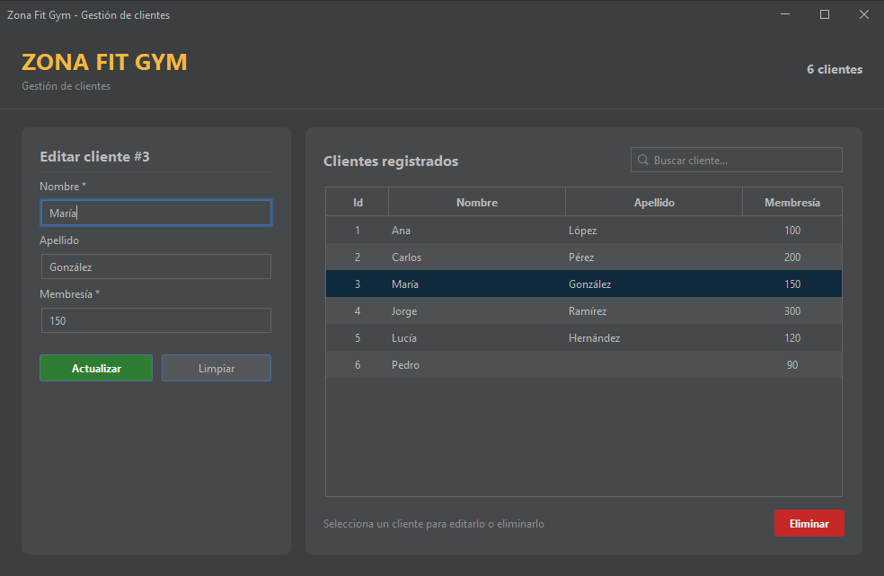

# Zona Fit Gym

Aplicación de escritorio para gestionar los clientes de un gimnasio: alta, consulta, edición, búsqueda y eliminación.
Proyecto personal hecho para practicar Spring Boot con una interfaz Swing.



## Tecnologías

- Java 25
- Spring Boot 4.1 (inyección de dependencias, Spring Data JPA / Hibernate)
- MySQL
- Swing + [FlatLaf](https://www.formdev.com/flatlaf/) (tema oscuro Darcula)
- Lombok
- IntelliJ IDEA GUI Designer (`.form`)

## Funcionalidades

- Listado de clientes con orden por columna y filas alternadas
- Búsqueda en vivo (sin distinguir mayúsculas)
- Formulario de alta / edición con validación (la membresía solo acepta dígitos)
- Confirmación antes de eliminar
- Atajos: **Enter** guarda, **Esc** limpia el formulario

## Arquitectura

```
gui/          ZonaFitForma          Ventana Swing (presentación)
servicio/     IClienteServicio      Lógica de negocio, transaccional
              ClienteServicio
repositorio/  ClienteRepositorio    Acceso a datos (JpaRepository)
modelo/       Cliente               Entidad JPA  ⇄  tabla cliente
```

`ZonaFitSwing` arranca el contexto de Spring en modo no web y muestra la ventana.
`ZonaFitApplication` es una versión anterior de consola, actualmente desactivada.

## Cómo ejecutarlo

1. Crea la base de datos y la tabla con el script [`db/schema.sql`](db/schema.sql).
2. Configura las credenciales de MySQL (no se incluyen en el repositorio). Elige una opción:

   - **Archivo local:** copia `src/main/resources/application-local.properties.example` como
     `application-local.properties` en la misma carpeta y pon tu usuario y contraseña. Está en `.gitignore`.
   - **Variables de entorno:**

     | Variable      | Valor por defecto                            |
     |---------------|----------------------------------------------|
     | `DB_URL`      | `jdbc:mysql://localhost:3306/zona_fit_db`    |
     | `DB_USER`     | `root`                                       |
     | `DB_PASSWORD` | *(vacío)*                                    |

3. Abre el proyecto en **IntelliJ IDEA** y ejecuta `dc.zona_fit.ZonaFitSwing`.

> La ventana está diseñada con el GUI Designer de IntelliJ (`ZonaFitForma.form`). IntelliJ genera el código de la
> interfaz al compilar, por eso hay que ejecutarla desde el IDE (con *Settings → Editor → GUI Designer →
> Generate GUI into: Binary class files*).
